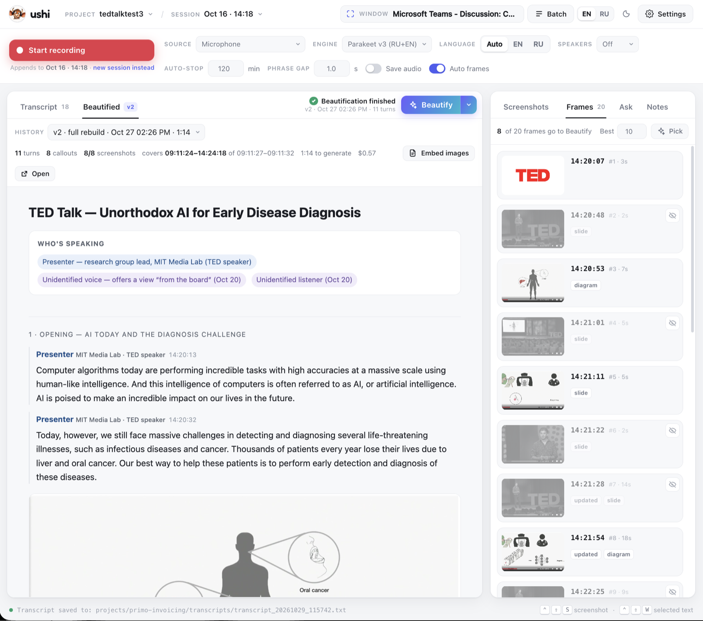

<p align="center"></p>

# ushi 

Local, real-time speech-to-text with screen capture. Narrate what you're doing on screen, record a call or play a YouTube talk -- ushi transcribes it with local models, keeps screenshots (on a hotkey or automatically) next to the words they belong to, and turns the result into a readable document with an LLM.

> 📝 **Article about this project:** [hybrismart.com](https://hybrismart.com/2026/10/25/voice-screen-local-models-en/) (also in [Russian](https://hybrismart.com/2026/10/25/voice-screen-local-models/) and [Ukrainian](https://hybrismart.com/2026/10/25/voice-screen-local-models-ua/)) · 🎬 [Demo video](https://www.youtube.com/watch?v=Jt3NA4wziVs)



## Download

The easiest way is the app: the web UI in its own window, with Python and all dependencies, the helpers and ffmpeg inside -- nothing to install.

**[⬇ Latest release](https://github.com/raliev/ushi/releases/latest)**

| Platform | File | Requires |
|---|---|---|
| macOS, Apple Silicon | `ushi-<version>-arm64-none-models.dmg` | macOS 14+ |
| macOS, Intel | `ushi-<version>-x64-none-models.dmg` | macOS 14+ |
| Windows | `ushi-Setup-<version>-x64.exe` | Windows 10/11 |

- **Models** are not inside: each one is downloaded on first use, with progress on screen; after that everything works offline.
- **AI for Beautify and chat**: on first launch the app asks what to use -- [Claude Code](https://claude.com/claude-code) or an LLM API (Gemini, OpenAI, Anthropic, OpenRouter or any OpenAI-compatible server (DeepSeek, ...), including local Ollama and LM Studio). Recognition is always local.
- **The builds aren't signed.** macOS: open the app the first time via right-click → **Open** (macOS 15+: System Settings → Privacy & Security → **Open Anyway**), or run `xattr -cr /Applications/ushi.app`. Windows: SmartScreen says "Windows protected your PC" -- **More info** → **Run anyway**.
- **Permissions** (macOS): Microphone, Screen Recording (screenshots), Accessibility (selected text capture) and, for an app's audio, System Audio Recording. **Help** in the app has shortcuts to these settings.

To run from source instead, see [Setup](#setup); to build the app yourself, [macOS app](#macos-app) and [Windows](#windows).

## Features

**Recognition -- local only.** Audio and screenshots never leave the machine.
- Three engines, all on CPU with int8: [faster-whisper](https://github.com/SYSTRAN/faster-whisper) `large-v3-turbo` (default, any language, takes term hints), [GigaAM v3](https://github.com/salute-developers/GigaAM) (Russian, ~20× faster than Whisper) and [Parakeet TDT v3](https://huggingface.co/nvidia/parakeet-tdt-0.6b-v3) (mixed Russian/English) -- see [ASR engines](#asr-engines). Whisper uses an NVIDIA GPU when there is one.
- [Silero VAD](https://github.com/snakers4/silero-vad): only speech is recognized; Russian/English auto-detection; `[HH:MM:SS]` timestamps taken from the audio, so they stay right even when recognition lags behind.
- Term hints from the project notes (`--vocab-file`) and "heard → meant" corrections.
- Optional speaker diarization ([SpeechBrain](https://github.com/speechbrain/speechbrain) ECAPA-TDNN), re-computable later without re-recording.

**Sources.**
- Microphone (it also hears the speakers -- YouTube, a call on speakers).
- One app's audio, e.g. Teams, Zoom, Meet in a browser -- alone or **app + mic** as `[Them]` / `[Me]` lines (Core Audio process taps on macOS 14.2+, WASAPI process loopback on Windows). Works with headphones.
- Audio and video files: real-time with a player, or in the background as fast as recognition goes; a start/end range; frames taken straight from the video.
- **Batch**: a queue of YouTube links → download (yt-dlp, subtitles as a second source) → transcribe → Beautify, each in its own project.

**Screen.**
- Global hotkeys: `Ctrl+Shift+S` -- screenshot + OCR ([EasyOCR](https://github.com/JaidedAI/EasyOCR)), `Ctrl+Shift+W` -- paste the selected text into the transcript verbatim.
- Capture the full screen, an area or one window (even when covered).
- **Auto frames**: a frame every second, kept only when a new scene stays on screen (pixel triage + CLIP filter that drops talking heads); **Detect video** crops to the player inside a browser or call window. See [Auto frames](#auto-frames).
- Hide lines, screenshots and frames (one by one or "this and the similar ones"); **Pick** keeps the N frames that were talked about most.
- **Describe**: a vision LLM describes a screenshot or frame; descriptions and OCR are condensed into screen notes for Beautify.

**Web UI and documents.**
- Live transcript, screenshots and frames panels, Start/Stop/Cut, auto-stop that can be moved while recording; English or Russian UI.
- **Beautify**: a full annotated HTML transcript -- real speaker names, SUMMARY callouts (NEW / CONFIRMS / UPDATES in update runs), screenshots inline. Versions with logs and prompts; prompts editable per project; long transcripts processed in parts; a self-contained export with embedded images.
- **Ask**: chat about the recording while it is still running.
- **Notes** per project (who's who, terms, corrections, "who said it"), and an **external transcript** (Teams `.vtt`/`.docx`/`.txt`/`.srt`, YouTube subtitles) merged in: names from it, terms and times from ushi.
- Everything also works from the console (`main.py`, `beautify.py`, `batch.py`, `process_transcript.py`).

## Architecture

```
                  +-----------+
Microphone -----> | sounddevice|
                  +-----+-----+
                        |
                  float32 audio chunks
                        |
                  +-----v-----+       +------------------+
                  | Silero VAD | ----> | transcribe_queue |
                  +-----------+       +--------+---------+
                                               |
                                    +----------v-----------+
                                    | ASR engine (asr_engines)|
                                    +----------+-----------+
                                               |
                         +---------------------+---------------------+
                         |                                           |
                  +------v------+                             +------v------+
                  | Transcript  |                             | embed_queue |
                  |  (.txt file)|                             +------+------+
                  +-------------+                                    |
                                                           +---------v--------+
                                                           | SpeechBrain      |
                                                           | ECAPA-TDNN       |
                                                           | (speaker embeds) |
                                                           +------------------+

  +-------------------+       +----------+       +-----------+
  | screenshot_helper | ----> | OCR      | ----> | .txt next |
  | (Swift, global    |       | (EasyOCR)|       | to .png   |
  |  hotkeys)         |       +----------+       +-----------+
  +-------------------+
```

The system runs several threads concurrently:

1. **Audio capture** -- `sounddevice` streams microphone input at 16kHz mono
2. **VAD loop** (main thread) -- Silero VAD processes 32ms windows, detects speech start/end based on configurable silence threshold
3. **Transcription worker** -- dequeues speech segments, runs the ASR engine (Whisper / GigaAM / Parakeet), writes timestamped lines to the transcript file
4. **Embedding worker** (optional) -- computes speaker embeddings for phrase-level audio chunks for post-session diarization
5. **OCR worker** -- processes screenshots through EasyOCR, saves recognized text alongside images
6. **Screenshot helper** -- a native macOS binary (Swift/Carbon) that registers system-wide hotkeys and captures the full screen, an area or a single window (configurable via a JSON file it re-reads on every capture). It also provides the area/window picker overlays used by the web UI (`--select-region`, `--pick-window`, `--list-windows`, `--capture`)

The screenshot helper communicates with Python through stdout: it prints `SCREENSHOT:<path>` or `SELECTION:<base64>` lines that the main process reads and injects as markers into the transcript.

## Requirements

- macOS (screenshot helper uses Carbon/Cocoa APIs), or Windows 10/11 -- see [Windows](#windows)
- Python 3.10+
- ffmpeg (optional, for MP3 audio export)
- Screen Recording permission (for screenshots)
- Accessibility permission (for text selection capture)
- System Audio Recording permission (only for `--source app...`, macOS 14.2+)

## Setup

```bash
# Install Python dependencies
pip install -r requirements.txt

# Compile the screenshot helper
swiftc -O -o screenshot_helper screenshot_helper.swift \
    -framework Cocoa -framework Carbon -framework CoreGraphics
```

## Windows

Everything the web UI does works on Windows 10/11 too; the native macOS helpers have Python counterparts with the same command line and output (`native_helpers.py` picks the right one):

| macOS | Windows | |
|---|---|---|
| `screenshot_helper` (Swift) | `screenshot_helper_win.py` | Global hotkeys (`RegisterHotKey`), screenshots (`mss`), a window even when covered (`PrintWindow`), area / window pickers (tkinter overlay), auto frames, `Ctrl+Shift+W` selection via the clipboard |
| `audio_helper` (Core Audio taps) | `audio_helper_win.py` | **One app's audio** (WASAPI process loopback of the app's process tree) or **all system audio** (loopback of the default output device) |

Setup (Python 3.12; an NVIDIA GPU is used automatically when present):

```powershell
powershell -ExecutionPolicy Bypass -File setup_windows.ps1    # .venv + PyTorch (CUDA or CPU) + dependencies
.\webui.bat                                                    # http://127.0.0.1:8765
```

- **Calls (Google Meet, Slack huddles, Zoom, Teams, ...).** Pick *App + mic* and the app: *Google Chrome* (or Edge, Brave, ...) for Meet in the browser, *Slack*, *Zoom*, ... -- its audio becomes `[Them]`, the microphone `[Me]`. Only that app is recorded, with its child processes (the browser's audio service, Teams' WebView2), so music or notifications from other apps stay out; a browser is recorded with all its tabs. The app list shows those that have opened an audio session (● = playing now); an app that isn't running yet is waited for. **Use headphones**, or the microphone hears the other side too.
- Per-app capture (process loopback) works on Windows 11 and on Windows 10 2004+ (tested on 22H2, build 19045). Where Windows refuses it, the list offers only *All system audio* (everything the default output device plays) with a warning, and a recording set to an app falls back to it.
- **GPU.** `--device auto` (the web UI's default) runs Whisper in float16 on CUDA when there is a GPU (faster-whisper needs cuBLAS + cuDNN 9: `packaging/requirements-windows-cuda.txt`), and falls back to the CPU if they don't load. `--device cpu` forces the CPU.
- **Stop** sends `STOP` on the recorder's stdin (Windows has no SIGINT for child processes); Ctrl+C in the console works as before.
- **ffmpeg** is taken from `PATH`, else the static binary from `imageio-ffmpeg`.

**Windows app.** `ushi-Setup-<version>-x64.exe` installs the web UI as an app with everything inside (Python 3.12 and all dependencies, ffmpeg); models download on first use. Data lives in `%APPDATA%\ushi\data` (`%APPDATA%\Voice Rec\data` when upgrading from a Voice Rec install: the app keeps using it). Build it in Git Bash (needs [uv](https://docs.astral.sh/uv/) and Node 18+):

```bash
packaging/build_app_win.sh               # GPU=auto: bundles cuBLAS + cuDNN when this PC has an NVIDIA GPU
GPU=0 packaging/build_app_win.sh         # CPU only, smaller
MODELS=core packaging/build_app_win.sh   # also bundle models (see packaging/fetch_models.py)
cd app && VOICE_REC_PYTHON=..\.venv\Scripts\python.exe npm start   # dev run with the repo's venv
```

The bundled PyTorch is the CPU build (VAD, diarization, OCR, CLIP); Whisper uses the GPU through CTranslate2. The installer is not code-signed: on first start SmartScreen shows "Windows protected your PC" -- *More info* → *Run anyway*. Closing the app stops a running recording properly (it is finished and saved first).

## Usage

### Recording

```bash
# Basic recording (auto language detection)
python main.py myproject

# Specify language
python main.py myproject --lang ru

# With speaker diarization (2 speakers)
python main.py myproject --speakers 2

# Auto-detect number of speakers
python main.py myproject --speakers auto

# Save audio recording
python main.py myproject --save-audio

# Adjust silence threshold (seconds)
python main.py myproject --pause 2.0

# Another recognition engine (see "ASR engines")
python main.py myproject --engine gigaam
python main.py myproject --engine parakeet --vocab-file notes.md --vocab-correct
```

During recording:
- `Ctrl+Shift+S` -- take a screenshot
- `Ctrl+Shift+W` -- capture selected text
- `Ctrl+C` -- stop recording

### Audio source

`--source` (the *Source* list in the web UI) picks what to transcribe:

```bash
# One app's audio and the microphone as two channels: lines marked [Them] / [Me]
./build_audio_helper.sh                 # Core Audio process taps, macOS 14.2+
./audio_helper --list                   # apps connected to Core Audio (bundle ids)
python main.py myproject 60 --source app+mic:com.microsoft.teams2

# Only the app's audio
python main.py myproject 60 --source app:com.microsoft.teams2

# An audio file (mp3, m4a, wav, video, ...; ffmpeg, or afconvert as a fallback);
# timestamps are positions in the file, no screenshots
python main.py myproject 60 --source file:meeting.m4a

# A video file, only 1:00-3:00, frames taken straight from the video (full resolution);
# as fast as the recognizer goes. Timestamps (transcript, frames) stay positions in the file.
python main.py myproject 60 --source file:talk.mp4 --start 1:00 --end 3:00 --auto-frames 1

# The same at playback speed, watching along in an ffplay window:
# Ctrl+Shift+S saves the video frame at the current position (not a screenshot)
python main.py myproject 60 --source file:talk.mp4 --start 1:00 --realtime --play
```

Batch: a queue of YouTube videos, each downloaded (yt-dlp, 3 at once), transcribed (one at a time, in the order the downloads finish) and optionally beautified (one at a time), each in its own project. The video's default subtitles (author-uploaded, else YouTube's captions in the original language) go into the project's external transcripts (Notes), bound to the session, and Beautify uses them. A failed or interrupted stage puts its task on hold with the reason; restarting it continues an interrupted transcription where it stopped. The web UI has it under **Batch** (`/batch`); from the console:

```bash
# tasks.csv: url[,project[,auto_frames[,beautify]]]  (header optional; project = YouTube id, flags = 1 by default)
python batch.py run tasks.csv [--parallel 3]   # standalone; state in tasks.csv.state.json - run again to resume
python batch.py submit tasks.csv               # into the running web UI's queue
python batch.py list                           # the web UI's queue
```

A file run ends with `Processed 00:01:00 - 00:02:20 (stopped early; resume with --start 140.7)` (and a `source_done` event), so an interrupted run can be picked up from there. With `--control-stdin`, `MUTE` / `UNMUTE` pause and resume reading the file, and `SNAP [<sec>]` saves the video frame at `<sec>` (default: the current position). In the web UI these are the **Audio file**, **Video file (real-time player)** and **Video file (background)** sources: the player under the control strip sets the range (**Set start** / **Set end**), and in real-time mode plays in step with the recognizer.

`audio_helper` writes 16 kHz mono float32 to stdout, paced by the wall clock (zeros while the app is silent), so both channels share one timeline. Each channel has its own VAD. With `--speakers`, only `[Them]` lines are diarized. macOS asks for the *System Audio Recording* permission. Teams plays call audio from its `ModuleHost` helper process, which is grouped under the app. The web UI also has a **Cut** button that ends the current phrase without waiting for the pause (`CUT` on `--control-stdin`).

Output is organized per project:

```
projects/
  myproject/
    transcripts/
      transcript_20260618_143022.txt
    screenshots/
      screenshot_20260618_143045_123.png
      screenshot_20260618_143045_123.txt   # OCR result
    session_20260618_143022.pkl            # diarization data
```

### Web UI (studio)

A browser interface on top of the same recorder. The console mode above still works unchanged.

```bash
./webui.sh                      # or: python server.py  → http://127.0.0.1:8765
VOICE_REC_PYTHON=/path/to/python ./webui.sh --port 9000 --no-browser
```

- **Start / Stop**: runs `main.py` as a subprocess. Stop sends SIGINT, exactly like Ctrl+C.
- **Live transcript**: phrases appear as they're recognized, with a mic level meter and listening / transcribing state.
- **Screenshots panel**: each capture shows its pipeline status: Captured → Transcript → OCR → Beautified vN. `Snap` takes one without the hotkey.
- **Capture area**: full screen, a dragged **area**, or a specific **window**. A window is captured even when other windows cover it. Changes apply immediately, even mid-recording, so the UI itself can stay out of screenshots.
- **Beautify**: builds a *full* annotated transcript (every utterance, real speakers, a SUMMARY callout per topic, screenshots inline; *Update* runs mark the new part with NEW / CONFIRMS / UPDATES callouts against what was known before) through Claude Code (`claude -p`) or an LLM API (see **AI** below). Every press creates a new version:
  - *Update* (default) extends the previous version with the new material.
  - *Full rebuild* regenerates the whole document.
  - *Final* uses the diarized transcript and is also copied to `docs/` (self-contained, images embedded, plus a text-only version). When recording stops, the UI offers to build it.
  - Through an API, a long transcript is split into ~25,000-character parts at the longest pause, one request each; a cut-off answer is asked to continue.
  - Every version has a log (`vN.log`) and the prompt that went to the model; any earlier version can be opened. **Edit prompt(s)** in the Beautify menu changes the prompts for the current project only.
  - **Embed images** (next to *Open*) saves the shown version as `vN-emb.html` with every image embedded as a `data:` URI: one file that opens anywhere, to share without the `screenshots/` and `frames/` folders.
- **Ask**: chat about the transcript (live or saved) while recording keeps running. It follows up with only the new lines.
- **Notes**: one file per project, `projects/<name>/notes.md`, sent with every Beautify and Ask request as authoritative context: who's who, the client, terms that are often misheard. Edits are saved as you type.
- **AI**: Beautify and Ask run through Claude Code, or through an LLM API (Settings → AI): Gemini, OpenAI, Anthropic, OpenRouter, a local model in **Ollama** or **LM Studio** (no key; *Test* lists the installed models), or any OpenAI-compatible host (vLLM, llama.cpp server, a gateway).
- **Language**: English or Russian (the EN | RU switch in the top bar; `web/i18n.js`). The default follows the browser.

**Security.** The server has no login, so it only answers requests addressed to `127.0.0.1` / `localhost` (DNS rebinding) whose `Origin`, when a browser sends one, is the UI itself (other web pages can't drive it or open its WebSocket). Files under `/files/` are served with `script-src 'none'`. Beautify's Claude Code may write only into the session's folder (the transcript is untrusted input). To open the UI from another machine: `--host 0.0.0.0 --allow-host <name>` -- anyone who can reach the port then controls it.

Per-project settings (gear icon) live in `projects/<name>/project.json`:
- **Knowledge folder**: Claude Code runs there, so its MCP servers (e.g. `claude-context`) are available for callouts.
- **Style reference**: the HTML whose look to copy. Defaults to `templates/annotated_transcript_style.html`.

**Corrections and speakers from a selection.** Select text in the transcript or in a Beautified version and a popover offers two modes:

- *Fix text*: adds `- "heard" → "meant"` under `## Corrections` in the notes. Beautify and Ask apply it everywhere (other spellings too), and the recorder uses it as a vocabulary hint (`--vocab-file`).
- *Who said it*: adds `- "quote" <-- Name  (at HH:MM:SS)` under `## Who said it`. Beautify attributes that turn to the person and uses it to recognise the same voice elsewhere; an *Update* run re-checks speakers in the existing part as well. Names already known (from these lines or an external transcript) are suggested.

**External transcript.** Another tool's transcript of the same meeting (e.g. Microsoft Teams: `.vtt`, `.docx`, `.txt`, `.srt`) can be uploaded or dropped in the Notes tab. It usually has reliable speaker names but garbled brands and terms, while ours is the other way round, so Beautify merges the two: speakers from the external one, terms and times from ours, and anything ours missed recovered from it. Files go to `projects/<name>/external/` (the original, a normalized `<name>.transcript.txt` with merged `[HH:MM:SS] Speaker: text` turns, and `index.json`). Each file belongs to the session that was open when it was uploaded; click its label to use it for all sessions of the project instead. Ask is told about it too.

Beautify also works from the console:

```bash
python beautify.py myproject 20260928_110051 --mode full     # or: latest, --mode final
python beautify.py myproject 20260928_110051 --embed 3        # v3.html → v3-emb.html, images embedded (one file to share)
```

Files: versions in `projects/<p>/sessions/<sid>/vN.html` (+ `manifest.json`, transcript snapshots, `chat.json`, `events.jsonl`); notes in `projects/<p>/notes.md`; external transcripts in `projects/<p>/external/`; UI state in `.webui/`.

### macOS app

`ushi.app` is the web UI in its own window, with everything inside: Python 3.12 and all dependencies, the screenshot and audio helpers, ffmpeg. The [released DMGs](https://github.com/raliev/ushi/releases/latest) have no models (each is downloaded on first use); a build of your own can include all of them -- Silero VAD, Whisper large-v3-turbo, GigaAM v3, Parakeet v3, CLIP, ECAPA, EasyOCR -- and then works offline from the start. Apple Silicon or Intel (`ARCH=x64`), macOS 14+.

Build it (`app/dist/ushi-<version>-arm64.dmg`, ~4 GB with all models):

```bash
packaging/build_app.sh                 # Python runtime + models + helper + Electron → DMG
MODELS=core packaging/build_app.sh     # without Whisper/Parakeet (~1.5 GB smaller; downloaded on first use)
MODELS=none packaging/build_app.sh     # no models at all
REBUILD_PYTHON=1 packaging/build_app.sh   # after changing packaging/requirements-app.txt
cd app && npm start                    # dev run: repo sources, build/python, build/models
```

The steps are separate scripts: `packaging/build_python.sh` (relocatable [python-build-standalone](https://github.com/astral-sh/python-build-standalone) CPython in `build/python`, pinned deps from `packaging/requirements-app.txt`), `packaging/fetch_models.py` (clone-copies models from the local caches into `build/models`, downloads the missing ones), `app/` (Electron shell, `electron-builder` config in `app/package.json`).

How it runs: the app starts the bundled `server.py` on a free local port and opens it in a window. Data lives in `~/Library/Application Support/ushi/data` (`…/Voice Rec/data` for an install from before the rename; `projects/`, `.webui/`, `logs/server.log`); **File → Change Data Folder…** points it elsewhere, e.g. at this repo to reuse its projects. On first launch the bundled models are copied into `data/models` (an APFS clone: instant and no extra disk space when the app is in /Applications), so the libraries see a normal writable cache. Beautify and chat use [Claude Code](https://claude.com/claude-code) when it is installed (`claude` is looked up in the login shell's `PATH`), or an LLM API: Gemini, OpenAI, Anthropic, OpenRouter or any OpenAI-compatible host (Ollama, LM Studio, vLLM) -- chosen on first launch or in **Settings → AI** (`llm_api.py`; keys are kept in `.webui/secrets.json`, mode 600, or taken from `GEMINI_API_KEY`, `OPENAI_API_KEY`, ...). Code paths: `VOICE_REC_DATA` (data folder), `VOICE_REC_SILERO_DIR`, `VOICE_REC_RECORDER_PYTHON`; without them the console tools and `server.py` behave exactly as before.

Signing: with a "Developer ID Application" certificate in the keychain the build is signed with it, and notarized when `APPLE_ID`, `APPLE_APP_SPECIFIC_PASSWORD` and `APPLE_TEAM_ID` are set -- then it opens on any Mac with no warnings. Without one the app is signed ad hoc: on another Mac the first launch is blocked as from an unidentified developer -- open it once via right-click → **Open** (macOS 15+: System Settings → Privacy & Security → **Open Anyway**), or run `xattr -cr "/Applications/ushi.app"`. macOS then asks for Microphone, Screen Recording (first screenshot) and Accessibility (selection capture) permissions; **Help** has shortcuts to these settings.

### Re-diarization

If speaker labels need tuning, re-run diarization on saved session data without re-recording:

```bash
# Inspect embeddings and distance matrix
python rediarize.py myproject --debug

# Sweep threshold values to find optimal setting
python rediarize.py myproject --sweep

# Re-diarize with specific parameters
python rediarize.py myproject --speakers 2
python rediarize.py myproject --cluster-threshold 0.4
```

### Post-processing

Clean up transcripts using an LLM (Gemini, OpenAI, or OpenRouter). The LLM corrects speech recognition errors using OCR'd screenshot text as reference, then generates HTML output.

```bash
# Set API key
export GEMINI_API_KEY=...   # or OPENAI_API_KEY, OPENROUTER_API_KEY

# Process a day's transcripts
python process_transcript.py myproject 2026-06-18

# Date range
python process_transcript.py myproject 2026-06-17 --to 2026-06-18

# Time range within a day
python process_transcript.py myproject 2026-06-18 --time-from 14:00 --time-to 15:30

# Choose model/provider
python process_transcript.py myproject 2026-06-18 --model gpt-4.1-mini
python process_transcript.py myproject 2026-06-18 --provider openrouter
```

Output goes to `projects/myproject/docs/` as both `.txt` and `.html`.

## ASR engines

`--engine` picks the speech recognizer (`asr_engines.py`). All engines feed the same transcript format and word timestamps, so diarization, screenshots and the web UI work the same with each.

| Engine | Model | Languages | Notes |
|---|---|---|---|
| `whisper` (default) | faster-whisper `large-v3-turbo`, int8 | any, auto-detect | Supports vocab hints (`hotwords`); slowest on CPU; can hallucinate on silence |
| `gigaam` | GigaAM v3 e2e RNN-T (`gigaam-v3-e2e-rnnt`), int8 | Russian only | Best for Russian; punctuation, ё; `--lang en` is refused |
| `parakeet` | NVIDIA Parakeet TDT 0.6B v3, int8 | 25 European incl. ru/en, auto-detect | Good for mixed ru/en; weaker than GigaAM on Russian |

- `--asr-model` overrides the model: a Whisper size, or an onnx-asr name such as `gigaam-v3-e2e-ctc`.
- GigaAM and Parakeet have no `hotwords`. With `--vocab-correct`, `- "heard" → "meant"` lines from `--vocab-file` are applied to the output as replacements instead.
- Long phrases are split into ≤20 s (GigaAM) / ≤60 s (Parakeet) chunks at the quietest point, since the models degrade on long input.
- Models download into the Hugging Face cache on first use (GigaAM ~250 MB, Parakeet ~700 MB). To fetch them ahead of time:

  ```bash
  python -c "import onnx_asr; onnx_asr.load_model('gigaam-v3-e2e-rnnt', quantization='int8')"
  python -c "import onnx_asr; onnx_asr.load_model('nemo-parakeet-tdt-0.6b-v3', quantization='int8')"
  ```

Measured on an M3 Max, CPU, 140 s of Russian speech in 7 phrases (`bench_asr.py`):

| Engine | Compute | RTF | Peak RAM |
|---|---|---|---|
| whisper | 90.0 s | 0.64 | 2.3 GB |
| gigaam | 4.4 s | 0.031 | 0.7 GB |
| gigaam-ctc | 4.3 s | 0.030 | 0.6 GB |
| parakeet | 4.8 s | 0.034 | 1.6 GB |

To compare engines on your own recording (run it while the recorder is stopped):

```bash
python bench_asr.py projects/myproject/recording_20261007_083740.mp3 --start 60 --dur 300 --ref reference.txt
```

`--ref` is a hand-corrected transcript of the same range; with it the script reports WER/CER. Per-engine transcripts go to `bench_out/`.

## Auto frames

Instead of (or besides) pressing the hotkey, the screen can be captured every second and only the frames worth keeping are stored. Turn it on with `--auto-frames 1`, the **Auto frames** switch before recording, or the **Auto** button while recording.

```bash
python main.py myproject 60 --auto-frames 1
```

How frames are filtered (`autoframes.py`, Level 0, pixels only, ~20 ms per frame):

- a frame becomes a candidate only after the screen has stood still for 1.5 s after a change, so transitions, scrolling in progress, typing and talking heads never qualify;
- regions that keep moving (a webcam picture-in-picture) are masked out; a mostly-moving frame is treated as video and skipped; a still frame with motion and little detail elsewhere is treated as a camera view and skipped;
- a candidate opens a new *scene* if its changed area differs from the current scene by more than 3%, otherwise it extends the scene (or, between 0.5% and 3%, replaces the scene's "last state" image, e.g. a form being filled in);
- going back to a recent slide is recorded as a revisit (`same_as`), a vertically shifted frame is marked `scroll_of`.

**Detect video** (capture popover). When the capture is a whole browser or call window, most of it is static page and the video is one rectangle, so slide changes look tiny and slides get merged. With the video playing, *Detect video* watches the area for ~6 s and finds the player (`video_detect.py`): a decoded video flickers by a level or two even on a still slide while a rendered page is bit-for-bit static, so the flickering blob is the video; it is snapped to the player border if one is visible, otherwise grown to a video aspect ratio and padded. A paused video is found by its border alone. The crop is drawn on the capture preview: drag it to move, drag an edge or corner to resize (or *Set by hand* without detecting); it takes effect on the next frame, even mid-recording. The crop (`frames_crop` in the capture config, fractions of the area) applies to auto frames only; screenshots stay whole; choosing another capture area resets it.

Besides the changed area, a candidate also counts as a new scene when more than half of the slide's *content* changed (a new title on a dark, almost empty slide), and drift is measured from the scene's first state too, so small steps can't add up to swallowing a slide.

Scenes are saved in `projects/<project>/frames/<session>/` (`scenes.json` + JPEGs) and shown in the transcript at the moment they appeared (marked *auto*); clicking a card in the **Frames** tab scrolls the transcript there. The transcript file itself is not changed.

**Hiding.** Every transcript line, screenshot and auto frame has an eye button (on hover). A hidden line stays in place, faded; a hidden screenshot or frame turns grey. Hidden items are kept in `sessions/<session>/visibility.json` and **left out of Beautify**; everything visible goes in, and visible auto frames are given to it as screenshots at their time. Next to the eye, a second button hides **this and the ones like it** in one click (Undo in the notice): for lines, the same words after normalising, or mostly the same character trigrams for longer ones (recognizer hallucinations, repeated phrases, "угу"); for pictures, every screenshot and frame whose CLIP embedding is ≥ 0.88 to it (`similar.py`; the same talking head at different times was ≥ 0.93, different slides ≤ 0.84). Embeddings are cached in `.emb/` next to the images; Level 1 writes them while recording. **Pick** (Frames tab) keeps the N frames with most said about them (pointing phrases like "вот здесь", "as you can see", time on screen, words, novelty) and hides the rest; the eye brings any frame back. From the console:

```bash
python select_frames.py myproject 20261016_120000 -n 10 --apply
```

When a recording stops, the UI asks whether to build the final version (Settings → *Offer to build the final version*); "Not now" leaves the **Beautify** button for later.

To tune thresholds on a recorded talk (and measure recall against hand-made screenshots of it):

```bash
python autoframes.py talk.mp4 --out /tmp/frames [--truth projects/x/screenshots] [--scene-frac 0.03 ...]
```

It writes `index.html` with every scene for a quick look.

**Level 1** (`frames_l1.py`, on by default) runs CLIP ViT-B/32 (~14 ms per candidate on MPS, downloaded once, ~600 MB) on each Level-0 candidate:

- zero-shot class (slide, diagram, table, code, web, document, face, desktop), shown on the frame cards; a frame that is mostly a face, a webcam or a video call is dropped (`p(face) ≥ 0.6`);
- semantic dedup: a candidate with cosine ≥ 0.92 to a recent scene is that scene again (its "last state", or a revisit); 0.85–0.92 is kept but marked `l1_near`, and **Pick** takes only one of such a pair.

On a slide talk, different slides were ≤ 0.84 apart and the same slide later ≥ 0.966. Turn it off with `--no-frames-l1` (console), the *Smart filter* switch in Settings (web UI), or `--no-l1` (offline); if the model can't load, auto frames run on Level 0 alone.

**Text on frames.** New scenes are OCR'd like screenshots (`frame_x.txt`; after Stop the remaining ones are still read). The **Describe** button on a screenshot or frame sends it to a vision model (Settings: provider and model; OpenAI, Gemini, Anthropic or OpenRouter) and saves `<image>.desc.md`, which replaces the OCR text. Before Beautify, the texts of all the session's images go through one more request that drops boilerplate (menus, repeated pages, OCR noise); each part of the transcript then gets the screen notes of its time (`image_notes.py`, cached in `sessions/<sid>/screen_notes.json`).

Planned: a final frame pick by a text LLM over the transcript and the scene list.

## Configuration

Key constants in `main.py`:

| Parameter | Default | Description |
|---|---|---|
| `MODEL_SIZE` | `large-v3-turbo` | Whisper model variant (`--engine whisper`) |
| `DEVICE` | `cpu` | Inference device (`cpu` or `cuda`) |
| `COMPUTE_TYPE` | `int8` | Quantization for faster-whisper |
| `VAD_THRESHOLD` | `0.5` | Speech probability threshold |
| `SILENCE_DURATION_MS` | `1500` | Silence before ending a phrase |
| `MIN_SPEECH_DURATION_MS` | `250` | Minimum speech to transcribe |
| `BEAM_SIZE` | `5` | Whisper beam search width |

## File overview

| File | Purpose |
|---|---|
| `main.py` | Main app: audio capture, VAD, transcription, screenshot integration |
| `asr_engines.py` | Speech recognition engines (Whisper, GigaAM, Parakeet) behind one interface |
| `autoframes.py` | Auto frames: Level-0 triage of the 1 fps capture into scenes; offline mode for videos |
| `video_detect.py` | Find the playing video in a captured window (crop for auto frames) |
| `similar.py` | "Hide this and similar" for pictures (CLIP embeddings, cached) |
| `frames_l1.py` | Auto frames Level 1: CLIP class (drops faces) and semantic dedup |
| `select_frames.py` | Score scenes against the transcript, keep the best N visible (hide the rest) |
| `bench_asr.py` | Compare engines on a recording: speed, memory, WER/CER |
| `screenshot_helper.swift` | Native macOS helper for global hotkeys and screen capture |
| `speaker_id.py` | Speaker embedding (ECAPA-TDNN) and agglomerative clustering |
| `rediarize.py` | Re-run diarization on saved sessions with different parameters |
| `process_transcript.py` | LLM-based transcript cleanup and HTML generation |
| `server.py` | Web UI server (FastAPI + WebSocket); drives `main.py`, Beautify and chat |
| `web/` | Web UI front end (static HTML/CSS/JS, no build step); `i18n.js`: Russian UI |
| `native_helpers.py` | Picks the screenshot / audio helper for the platform; ffmpeg lookup, UTF-8 stdio, CUDA DLLs |
| `screenshot_helper_win.py` | Windows counterpart of `screenshot_helper` (same CLI and output) |
| `audio_helper_win.py` | Windows counterpart of `audio_helper`: system audio via WASAPI loopback |
| `setup_windows.ps1`, `webui.bat` | Windows setup (venv, PyTorch CUDA/CPU, dependencies) and launcher |
| `app/` | macOS app: Electron shell (`main.js`), build config (`package.json`), icon and entitlements |
| `packaging/` | App builds (macOS and Windows): `build_app.sh`, bundled Python runtime, models, icon |
| `beautify.py` | Full annotated transcript via Claude Code or an LLM API (also a console tool) |
| `image_notes.py` | Screen notes for Beautify: OCR / vision descriptions (Describe) of images, condensed |
| `media_file.py` | Audio/video files as a source: probing, time range, frames from the video |
| `batch.py` | YouTube batch queue: download → transcribe → Beautify (also a console tool) |
| `llm_api.py` | Beautify / chat through an LLM API (OpenAI-compatible protocol), provider settings and keys |
| `downloads.py` | Progress of models downloaded on first use |
| `claude_cli.py` | Helpers for headless `claude -p` (stream-json parsing, progress labels) |
| `sessions.py` | Transcript parsing, session listing, settings, notes (corrections, speakers), beautify manifests |
| `external.py` | External transcripts (Teams etc.): parsing, storage, binding to sessions |
| `events.py` | Optional JSON-lines event stream from `main.py --events` |
| `templates/annotated_transcript_style.html` | Default style reference for Beautify |
| `requirements.txt` | Python dependencies (`packaging/requirements-windows*.txt` for Windows) |
